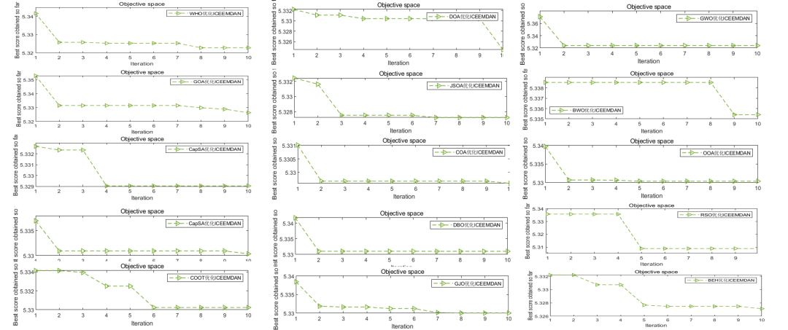
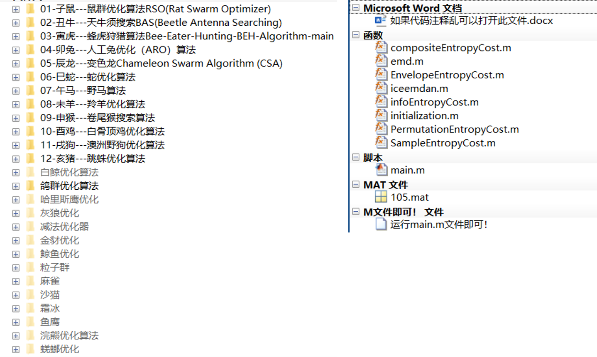

# "Zodiac Algorithm" + Optimization of 14 Common Algorithms with ICEEMDAN, Five Adaptation Functions to Switch at Will, Learn This Article and Even Beginners Can Code!

"Chinese Zodiac Intelligence Algorithms" are the intelligent optimization algorithms summarized by the author for entertainment purposes. The specifics are as follows:
Overview
Chinese Zodiac Intelligence Algorithms
Sub-Zodiac Rat - Rat Swarm Optimizer (RSO) - 2020
Sub-Zodiac Ox - Beetle Antenna Searching (BAS) - 2017
Sub-Zodiac Tiger - Beetle Antenna Searching (BAS) - 2022
Sub-Zodiac Rabbit - Artificial Rabbits Optimization (ARO) - 2022
Sub-Zodiac Dragon - Chameleon Swarm Algorithm (CSA) - 2021
Sub-Zodiac Snake - Snake Optimizer (SO) - 2022
Sub-Zodiac Horse - Wild Horse Optimizer (WHO) - 2021
Sub-Zodiac Sheep - Gazelle Optimization Algorithm (GOA) - 2022
Sub-Zodiac Monkey - Capuchin search algorithm (CapSA) - 2020
Sub-Zodiac Rooster - Coot optimization algorithm (COOT) - 2021
Sub-Zodiac Chicken - Coot optimization algorithm (COOT) - 2021
Sub-Zodiac Dog - Dingo Optimization Algorithm (DOA) - 2021
Sub-Zodiac Pig - Jumping Spider Optimization Algorithm (JSOA) - 2021
New in 2024: Crowned Porcupine Algorithm (CPO)
The author of this issue optimizes the two parameters of the ICEEMDAN decomposition method using this "twelve-animal" algorithm.
Of course, the algorithm code includes not only these twelve algorithms but also 13 other commonly used and quite popular algorithms:
Includes: 1.1 Black-capped Chinchilla Optimization Algorithm (COA), 1.2 Scarab Optimization Algorithm (DBO), 1.3 Golden Cheetah Optimization Algorithm (GJO), 1.4 Gray Wolf Optimization Algorithm (GWO), 1.5 Osprey Optimization Algorithm (OOA), 1.6 Particle Swarm Optimization Algorithm (PSO), 1.7 Subtraction Optimizer Algorithm (SABO), 1.8 Sand Cat Swarm Optimization Algorithm (SCSO), 1.9 Sparrow Optimization Algorithm (SSA), 1.10 White Whale Optimization Algorithm (BWO), 1.11 Frost Ice Optimization Algorithm (RIME), 1.12 Whale Optimization Algorithm (WOA), 1.13 Harris Hawk Optimization Algorithm (HHO).
A total of 25 algorithms! Switching between algorithms is very simple; the author has already written a variable named 'number'. Simply modify this number to switch between algorithms! Following this approach, everyone can easily replace their desired algorithm! The code for switching algorithms is as follows:
Modify the number here to call different algorithms in the str string. No changes are needed elsewhere in the program!
number = 1;   % Modify the number to correspond to the following algorithm, implementing a one-click switch algorithm. 1 is RSO, 2 is BSA, 3 is BEH, and so on.\nstr={'RSO','BAS','BEH','ARO','CSA','SO','WHO','GOA','CapSA','COOT','DOA','JSOA','COA','DBO','GJO','GWO','OOA','PSO','SABO','SCSO','SSA','BWO','RIME','WOA','HHO'};\n% Rat Swarm Optimization Algorithm RSO\n% Beetle Antennae must search for BAS\n% - BeeHunting Algorithm (BEH)\n% - Artificial Rabbit Optimization (ARO) Algorithm\n% - Chameleon (CSA)\n% - Snake Optimization Algorithm (SO)\n% Wild Horse Algorithm (WHO)\n% Leopard Optimization Algorithm (GOA)\n% End-of-Line Monkey Search Algorithm (CAPSA)\n% -White Bone Top Chicken Optimization Algorithm (COOT)\n% Australian State Wild Dog Optimization Algorithm (DOA)\n% Black Bear Optimization Algorithm (COA)\n% Gyratory Optimization Algorithm (DBO)\n% Jincao Optimization Algorithm (GJO)\n% Gray Wolf Optimization Algorithm (GWO)\n% Otter Optimization Algorithm (OOA)\n% Particle Swarm Algorithm (PSO)\n% Subtraction Optimizer Algorithm (SABO)\n% Sand Cat Cluster Optimization Algorithm (SCSO)\n% Scavenger Optimization Algorithm (SSA)\n% White Whale Optimization Algorithm (BWO)\n% Frost Ice Optimization Algorithm (RIME)\n% Whale Optimization Algorithm (WOA)\n% Harris Hawk Optimization Algorithm (HHO)\n% Added 2024 Crown Hao Pig Algorithm (CPO)\n  
The code also supports a one-click switch to the fitness function. The following code is an example: change xz here to switch the fitness function at will!
xz = 1;\n% 1, select the smallest entropic fitness function.\n% Select 2, using the minimum sample entropy as the fitness function.\n% Select 3, using the minimum information entropy as the fitness function.\n% Select 4, using the minimum arrangement entropy as the fitness function.\n% Select 5, using the compound index: entropy/mutual information entropy as the fitness function. References: Parameter optimization variational mode decomposition for GNSS coordinate time series noise reduction method - Lu Tie Ding\nif xz == 1\n    fobj=@(x)EnvelopeEntropyCost(x,da);          % Minimum Entropy\nelseif xz == 2\n    fobj=@(x)SampleEntropyCost(x,da);            % Minimum sample entropy\nelseif xz == 3\n    fobj=@(x)infoEntropyCost(x,da);             % Minimum Entropy\nelseif xz == 4\n    fobj=@(x)PermutationEntropyCost(x,da);      % Minimum Arrangement Entropy\nelseif xz == 5\n    fobj=@(x)compositeEntropyCost(x,da);     % Using the compound index: entropy of arrangement/mutual information entropy as the fitness function.\nend\nFor the introduction of the five fitness functions mentioned in this period, you can refer to the following link.:   
Why VMD needs to undergo parameter optimization, including minimum enclosing entropy/sample entropy/permutation entropy/information entropy, and which fitness function should be chosen?
The running speed has finally improved! Optimize the parameters of VMD, switch among five fitness functions freely, including minimum enclosing entropy, sample entropy, information entropy, permutation entropy, and permutation entropy/mutual information entropy.
Although the above two articles are about VMD decomposition, this fitness function is also applicable to the ICEEMDAN decomposition!
Results Display
Due to the variety of algorithms, this article will take the minimum enclosing entropy as an example for demonstration:
Data selection from the "105.mat" file of Xichu University bearing data, which is a time series data with over 600,000 rows and one column. Therefore, you can easily replace the data!
Here are several algorithms selected for demonstration, all of which have been tested by their authors and there are no issues!
Some code from this article
%% Optimize the ICEEMDAN with the minimum entropies of the smallest envelope, smallest sample, smallest information and smallest permutation as objective functions (choose one), using GWO algorithm to find the optimal two parameters of ICEEMDAN.\nclear\nclc\nclose all\naddpath(genpath(pwd))\n%% Select data\nload 105.mat\nda = X105_DE_time(6501:6800); % Here, select the DEtime data of 105, note that you can replace it with your own data. The data format is n rows * 1 column, and the number of columns must be 1.\nxz = 1;\n% 1. Choose the minimum entropic fitness function as the fitness function.\n% Select 2, using the minimum sample entropy as the fitness function.\n% Select 3, using the minimum information entropy as the fitness function.\n% Select 4, using the minimum arrangement entropy as the fitness function.\n% Select 5, using the compound index: entropy/mutual information entropy as the fitness function. References: Parameter optimization variational mode decomposition for GNSS coordinate time series noise reduction method - Lu Tie Ding\n​\nif xz == 1\n    fobj=@(x)EnvelopeEntropyCost(x,da);          % Minimum Entropy\nelseif xz == 2\n    fobj=@(x)SampleEntropyCost(x,da);            % Minimum sample entropy\nelseif xz == 3\n    fobj=@(x)infoEntropyCost(x,da);             % Minimum Information Entropy\nelseif xz == 4\n    fobj=@(x)PermutationEntropyCost(x,da);      % Minimum Arrangement Entropy\nelseif xz == 5\n    fobj=@(x)compositeEntropyCost(x,da);     % Using the compound index: entropy of arrangement/mutual information entropy as the fitness function.\nend\n​\n​\n%% Set parameters\nlb = [0.15 50];    %The range of optimization for noise amplitude weight is set to [0.15, 0.6], and the range of optimization for noise addition times is set to [50, 600].\nub = [0.6 600];\ndim = 2;            % Optimize the number of variables\nMax_iter=15;       % Maximum number of iterations\nSearchAgents_no=20;       %Population size, it is best to set it as an even number here, because some algorithms take half of the population.\nThe code comments are very detailed! Every line has a comment.!   
The code directory is as follows:

## Images

<!-- PAYMENT_BLOCK -->

## Get this dataset

- Payment link (Stripe): [Buy now](https://buy.stripe.com/3cs8yP7sY87d0vu9AB)
- Payment QR code: 

<!-- /PAYMENT_BLOCK -->
